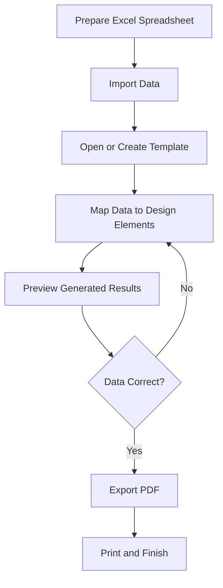

&#x20;\<div align="center">

# Layers Shift

### Variable Data Printing & Print Automation

**One template. Your data. Hundreds of personalized print-ready designs.**

Automate repetitive design production with spreadsheet-driven personalization.

[Product & Pricing](https://abdullahalkzaz.github.io/landing-pageLS/#pricing)

**Windows · macOS · Arabic · English**

\</div>

---

## Table of Contents

- [Overview](#overview)
- [The Problem](#the-problem)
- [Core Features](#core-features)
- [How It Works](#how-it-works)
- [Productivity Comparison](#productivity-comparison)
- [Use Cases](#use-cases)
- [Preparing Your Data](#preparing-your-data)
- [Installation & Activation](#installation--activation)
- [Troubleshooting](#troubleshooting)
- [Future Roadmap](#future-roadmap)
- [Support & Licensing](#support--licensing)

## Overview

**Layers Shift** is a desktop application built for Variable Data Printing (VDP) and print automation.

It helps designers, printing houses, educational institutions, and production teams generate personalized print materials from structured spreadsheet data without manually editing every design.

Connect an Excel spreadsheet to a reusable template, map data fields to design elements, review the generated results, and export your work to PDF for printing.

### The idea

**From repetitive manual editing to a structured production workflow.**

Layers Shift is designed to make variable-data jobs easier to organize, repeat, and scale.

## The Problem

Traditional personalized print production often involves repeating the same editing tasks for every record.

For example, producing 500 personalized certificates may require updating names, identification numbers, photos, or QR codes across hundreds of copies.

This workflow can consume valuable production time and introduce avoidable errors.

Layers Shift addresses this challenge by separating the reusable design template from the data that changes for each output.

## Core Features

### Excel Data Import

Import structured spreadsheet data and use it as the source for personalized output.

### Visual Data Binding

Connect spreadsheet columns to the appropriate fields in your design template.

### Drag-and-Drop Mapping

Organize data-to-design relationships through a visual workflow.

### Reusable Templates

Use a consistent template to generate multiple personalized variations.

### QR Code Personalization

Use record-specific data for QR code generation in supported workflows.

### PDF Export

Generate PDF output for downstream printing and finishing.

### Multilingual Interface

Support for Arabic and English workflows.

### Desktop Availability

Built for Windows and macOS, with license options described on the official product page.

## How It Works



### Step-by-step workflow

1. **Prepare your spreadsheet.** Organize the information required for each output.
2. **Import the data.** Load your spreadsheet into Layers Shift.
3. **Prepare the template.** Choose the design that will be reused.
4. **Map the fields.** Connect names, numbers, photos, QR data, and other supported variables.
5. **Review the output.** Check the generated designs and correct mapping errors.
6. **Export the PDF.** Prepare the approved output for the printing workflow.

## Productivity Comparison

The purpose of automation is to reduce repetitive work and make batch production more efficient.

The following example is **illustrative only, not a measured Layers Shift benchmark**.

### Example: Producing 250 personalized designs

Assumptions for this example:

- Manual workflow: 2 minutes per design.
- Automated workflow: 15 minutes for setup and 5 minutes for generation and review.

| Workflow                     | Estimated time |
| ---------------------------- | -------------: |
| Manual editing               |    500 minutes |
| Automated workflow           |     20 minutes |
| Illustrative time difference |    480 minutes |

### Estimated production time

```text
Manual editing       500 min | ████████████████████
Automated workflow    20 min | █
```

Under these hypothetical assumptions, the automated workflow takes 96% less time.

**Important:** These figures are a demonstration of how to compare workflows, not a claim about actual product performance. Real results depend on the template, data quality, hardware, output complexity, and verification requirements.

### How to measure actual performance

For a credible benchmark:

- Use the same dataset and design in both workflows.
- Include setup, correction, review, and export time.
- Run several trials at different batch sizes.
- Record errors and rework, not just generation speed.
- Publish the results with the test conditions and Layers Shift version.

A measured benchmark is more useful than a generic speed claim.

## Use Cases

| Industry                 | Example application                                 |
| ------------------------ | --------------------------------------------------- |
| Printing houses          | Personalized cards, labels, and certificates        |
| Schools and universities | Student certificates and personalized documents     |
| Graphic designers        | Batch production from reusable templates            |
| Marketing agencies       | Personalized print collateral                       |
| Organizations            | Membership cards and record-based printed materials |

The available fields and output options depend on the template and installed application version.

## Preparing Your Data

For reliable production:

- Use descriptive spreadsheet column headers.
- Keep one record per intended output.
- Check names, numbers, and required values before import.
- Keep formats consistent across rows.
- Verify image references and QR data where applicable.
- Test a small sample before generating the complete batch.
- Preserve a copy of the original data and approved output.

Avoid including sensitive customer information in screenshots or support requests.

## Installation & Activation

1. Visit the [official Layers Shift product page](https://abdullahalkzaz.github.io/landing-pageLS/#pricing).
2. Select the appropriate version for your operating system.
3. Download the installer from the official source.
4. Follow the installation instructions supplied with that release.
5. Activate your license according to the instructions provided with your purchase.

Refer to the current product documentation for exact operating-system requirements and activation procedures.

## Troubleshooting

**Spreadsheet import issues**

Check the file format, column headers, and required values.

**Incorrect generated content**

Review the field mappings and the corresponding spreadsheet records.

**Unexpected preview results**

Inspect the template elements and their associated data fields.

**PDF output problems**

Review the preview and available export settings before exporting again.

**License activation issues**

Follow the instructions for your purchased license and contact the official support channel if the problem persists.

When reporting a bug, include the application version, operating system, steps to reproduce the issue, and a screenshot with private data removed.

## Future Roadmap

The following items are ideas for future evaluation, not confirmed release commitments.

- [ ] Improve onboarding and first-project setup.
- [ ] Expand production validation and error reporting.
- [ ] Publish repeatable performance benchmarks.
- [ ] Improve documentation and example projects.
- [ ] Evaluate tablet support for production review.
- [ ] Evaluate a mobile companion application.
- [x] Explore cross-device project review and production status.

### Mobile & Tablet Strategy

The desktop application should remain the primary production environment for now.

A future mobile or tablet experience could focus on reviewing generated designs, checking job status, approving proofs, and monitoring production.

Advanced template editing and large-batch PDF generation should only move to mobile if there is a clear user need and a technically reliable implementation.

The goal is to extend the product ecosystem without delaying improvements to the desktop version.

## Support & Licensing

Layers Shift is commercial software. License availability, pricing, activation, and usage terms are governed by the official product information and purchase terms.

- **Product page:** [Layers Shift](https://abdullahalkzaz.github.io/landing-pageLS/#pricing)
- **Downloads and updates:** Refer to the official product source.
- **Support:** Use the official contact channel published with the product or your purchase.

## About

Layers Shift helps transform structured data into personalized print-ready output through reusable templates and variable-data automation.

**Less repetitive editing. More organized production.**

\<div align="center">

[Explore Layers Shift](https://abdullahalkzaz.github.io/landing-pageLS/#pricing)

\</div>

---

Copyright © 2026 Layers Shift. All rights reserved.

